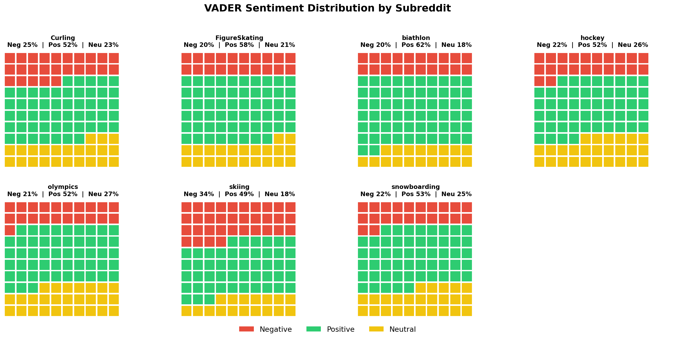
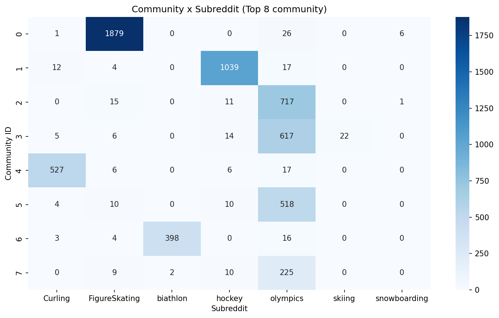

# Milano-Cortina 2026 on Reddit: Sentiment, Entities and Social Network Analysis

How did Reddit's winter-sports communities talk about the **Milano-Cortina 2026 Winter Olympics**?
This project collects ~25,000 Reddit comments and combines **sentiment analysis**, **named entity recognition** and **social network analysis** to answer three questions:

1. What is the emotional tone of the debate, and how does it differ across sports communities?
2. Which athletes, countries and organizations dominate the conversation?
3. How do users interact: are there influential hubs and separate communities?

> Group project for the *Social Media Analytics* course — MSc in Data Science, University of Milano-Bicocca (2026).

---

## Key findings

- **Overall positive tone**: 55% positive, 24% neutral, 21% negative comments (VADER).
- **Communities differ**: r/biathlon is the most positive community (62% positive), r/skiing the most critical (34% negative).
- **Two models, moderate agreement**: VADER and RoBERTa agree on 57.6% of comments; VADER tends to label ironic or ambiguous comments as positive.
- **Figure skating dominates the entities**: the most mentioned athletes are all figure skaters; Canada, Italy and the USA are the most cited countries.
- **Echo chambers**: the 74 communities detected in the interaction network (modularity 0.79) map almost one-to-one onto the sport subreddits — users mostly talk within their own discipline.

<p align="center">
  
</p>

---

## Data

| | |
|---|---|
| Source | Reddit, via the [Arctic Shift](https://github.com/ArthurHeitmann/arctic_shift) public API |
| Subreddits | r/olympics, r/FigureSkating, r/hockey, r/biathlon, r/Curling, r/skiing, r/snowboarding |
| Posts | 908 (keyword search: "Milano-Cortina", "2026 Olympics", "Winter Olympics", …) |
| Comments | 24,745 from 9,355 unique authors |
| Interactions | 20,691 user-to-user reply edges |

Comments were downloaded post by post with pagination and a pause between requests to respect the API usage policy. Deleted or empty comments were removed.

The raw data is not included in this repository because of its size. It can be re-collected by running `notebooks/01_data_collection.ipynb`.

---

## Methods

### 1. Sentiment analysis
- **VADER**: rule-based lexicon designed for social media; fast enough to score the full corpus.
- **RoBERTa** (`cardiffnlp/twitter-roberta-base-sentiment`): transformer fine-tuned on tweets, better with context.
- The two models are compared with an agreement matrix; sentiment is also tracked week by week and by subreddit.

### 2. Named Entity Recognition
- spaCy `en_core_web_sm` on a stratified sample of 8,000 comments.
- Entities (people, countries/cities, organizations, events, places) are counted and linked to the sentiment of the comment they appear in.

### 3. Social Network Analysis
- Directed, weighted graph: an edge goes from the author of a reply to the author of the parent comment.
- Full network: 8,698 users and 16,996 edges (main connected component: 8,372 users).
- **In-degree**, **betweenness** and **PageRank** to find influential users; **Greedy Modularity** for community detection (74 communities, modularity 0.79).
- For readability, the network plot shows only users with at least 5 interactions.
<p align="center">
  
</p>

---

## Repository structure

```
├── notebooks/
│   ├── 01_data_collection.ipynb          # Arctic Shift API: posts and comments
│   ├── 02_sentiment_analysis.ipynb       # VADER, RoBERTa, model comparison
│   ├── 03_ner_and_temporal_sentiment.ipynb  # spaCy NER, weekly sentiment
│   └── 04_social_network_analysis.ipynb  # graph, centrality, communities
├── images/                               # figures used in the report and README
├── report/
│   ├── report.pdf
│   └── slides.pdf
├── requirements.txt
└── README.md
```

---

## Limitations

- **Sentiment models disagree** on 42% of comments: results on irony and sarcasm should be read with caution.
- **NER on a sample**: entity counts come from 8,000 comments, not the full corpus, and the small spaCy model misses some names.
- **Reddit is not representative** of the general public: the audience is mostly English-speaking and North American.

---

## Tools

Python · pandas · VADER · Hugging Face Transformers (RoBERTa) · spaCy · NetworkX · matplotlib · seaborn · Google Colab

---

## Authors

- **Carlo Pegoraro** — [GitHub](https://github.com/NOMEUTENTE)
- **Davide Fabio Loreti**

### Contributions

| Part | Author |
|---|---|
| Data collection (Arctic Shift API) | Davide Fabio Loreti |
| Sentiment analysis (VADER, RoBERTa) and word clouds | Davide Fabio Loreti |
| Named Entity Recognition (spaCy) | Carlo Pegoraro |
| Social Network Analysis (centrality, community detection) | Carlo Pegoraro |
